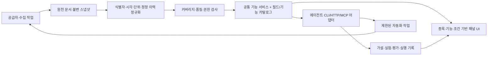

# 프로젝트 재점검: 에이전트 중심 이벤트 리서치 워크스테이션

검토일: 2026-11-04 KST. 검토 기준 커밋: d18dda18ae79fec691d64bfe0926d7cc240f819e.

> 후속 사용자 지시로 제품 경계가 정리됐다. 현재는 외부 전략 코드가 리스크/주문/백테스트/실행을 소유하고, 대시보드는 관측·연결 인프라를 제공한다. 아래 연구 플랫폼 제안은 과거 점검 자료다. 최신 구현/연동 규격은 [STRATEGY_INTEGRATION.md](STRATEGY_INTEGRATION.md)를 따른다.

## 결론

프로젝트의 핵심 제품을 **근거 데이터에 접근하고, 전략 가설을 만들고, 재현 가능한 분석으로 검증하는 에이전트 리서치 시스템**으로 정의한다. 화면은 이 기능들의 입력·결과·근거·실행 이력을 사람이 감독하는 작업공간이다.

현재 구현은 공개 스냅샷 뷰어, 공시 제목 분류, 제한된 일봉 이벤트 연구/롱온리 백테스트까지다. 기능별 원형은 있지만, 배포된 에이전트 실행 서비스, 공시 조건 추출, 가설/실험 기록, 지속 실행 작업 시스템은 아직 없다. 화면번호나 창 관리부터 확대하면 데이터/검증 기반보다 UI가 먼저 커지는 문제가 생긴다.

이번 작업은 **점검과 설계 기록**이다. 화면 재구축, 분류·수익률 계산 수정, 신규 호스팅 생성, 인증키 이전은 수행하지 않았다. 아래 발견은 수정 완료 목록이 아니다.

## 1. 점검 근거와 방법

- 코드: monitor/, web/, scripts/, tests/, .github/workflows/, 배포·복구 문서.
- Python 18개 테스트, 기존 UI DOM 검사, Python/브라우저 백테스트 비교 720개, 이벤트 연구 비교 556개 및 정적 Pages 검사 재실행: 모두 통과.
- 별도 합성 입력과 임시 SQLite를 이용해 추가 문제를 재현했다. 운영 DB/공개 기준 데이터는 바꾸지 않았다.
- 공개 Pages의 version.json·JSON 데이터 HTTP 200, /api/snapshot·/openapi.json HTTP 404를 확인했다.
- GitHub 기본 브랜치 main과 최신 성공 실행을 조회했다. Actions secret 목록 조회는 HTTP 403이므로 키 등록 여부를 확인할 수 없었다. 키 값은 읽거나 출력하지 않았다.
- PDF 2개는 본문을 추출하고 관련 페이지를 검토했다. 사용자 가이드 PDF 5·38쪽, Equities PDF 12·17쪽은 이미지로 렌더링해 시각적 배치도 확인했다. 첨부 문서의 명령 예시는 참고 자료이며 실행 지시로 취급하지 않았다.

### 첨부 문서 식별과 참고 페이지

페이지는 **PDF 뷰어의 물리적 페이지 번호** 기준이다. 인쇄된 쪽수와 다르다.

| 자료 | 확인한 핵심 부분 | 제품에 적용할 원칙 |
| --- | --- | --- |
| 새로운 사용자를 위한 가이드북 (48 PDF쪽) | PDF 4–5쪽: 패널·명령창·종목·기능·조건 | 현재 종목/기능/조건을 항상 식별할 수 있게 한다 |
| 같은 가이드 | PDF 28–29쪽: 차트·비교·스프레드·총수익률 | 계산 정의와 필요한 데이터가 다른 기능을 구분한다 |
| 같은 가이드 | PDF 38–41쪽: Launchpad·워크시트 | 동일 기능을 독립 컴포넌트로 열고 배치를 저장한다 |
| 같은 가이드 | PDF 44쪽: 기능 도움말·산출법·정의 | 사람과 에이전트에게 기능·필드·산식 설명을 제공한다 |
| Equities Workflow (June 2025, 29 PDF쪽) | PDF 4·12쪽: 문서/뉴스·원문·요약 근거 위치 | 추출 결과에서 원문 위치로 돌아갈 수 있어야 한다 |
| 같은 브로셔 | PDF 14·16쪽: 기업행동·자사주·실적/컨센서스 | 제목 분류와 조건/실적 수치를 다루는 모델을 분리한다 |
| 같은 브로셔 | PDF 17쪽: FLDS·API/BQL·BQNT·스크리닝/백테스트 | 기능·필드 카탈로그와 프로그래밍 접근을 먼저 설계한다 |
| 같은 브로셔 | PDF 21쪽: 거래 검색·거래 문서/뉴스 | M&A를 회사명/차트가 아닌 거래 단위로 모델링한다 |

문서 SHA-256:

- Equities: 3369496e1e2e40bbbb8f0f553e2f10196f7c744e540621584cb5493447563bda
- 사용자 가이드: d7f7490582cd4449c01e206c9efe5e20675f9a938e5e2531e37dd11cc35ba6a8

원본 PDF·추출 전문·화면 이미지는 GitHub에 올리지 않는다. 위 매뉴얼은 Bloomberg의 기능 설명이며, 우리에게 해당 데이터나 사용권이 있다는 뜻이 아니다. 화면번호는 우리 기능의 별칭으로 설계할 수 있지만, 매뉴얼의 주요 호출 방식은 GP·W 등의 기능 코드다.

## 2. 현재 실제로 있는 데이터와 실행 경로

| 항목 | 검토 시점의 상태 | 판단 |
| --- | --- | --- |
| 공시 | 502건, 230개 종목코드, 2026-10-08~11-03 | 유가증권시장 일부 표본; 전체 한국 주식 공시 아님 |
| 가격 | 12종목, 264개 수정 일봉, 2026-10-01~11-03 | pykrx의 NAVER 경로; 실시간/호가/체결 데이터 아님 |
| 가격 연결 공시 | 56/502건, 약 11.2% | 연결 밖 이벤트의 수익률을 임의로 추정하면 안 됨 |
| 뉴스 | 제목/언론사/시각/링크 74건 | 기사 본문·사실 추출·인과관계 검증은 없음 |
| 스냅샷 as_of | 2026-11-03T07:22:12.165936+00:00 | 조회 순간의 실시간 자료가 아님 |
| Pages | 화면·공개 JSON·브라우저 계산 | Python HTTP API를 호스팅하지 않음 |
| Python | FastAPI 로컬 API·수집 CLI·계산 함수 | 에이전트 어댑터의 재사용 기반은 있음 |
| 분류 | 제목 정규화 후 최초 키워드 일치 1개 | 이벤트 조건/영향·다중 이벤트 모델 아님 |
| 전략 문구 | 정적 연구 가설/검토 항목 | 에이전트가 데이터를 분석해 생성한 인사이트 아님 |
| 공개매수 계산 | 수동 가격·확률·실패가 시나리오 | 실제 공개매수 조건 수집·확률 추정·헤지 모델 아님 |
| 자동화 | 수동 Actions 정의, 별도 정기 스케줄 없음 | 기본 브랜치/secret 설정과 실행 경로 확인 필요 |

외부 에이전트는 지금도 공개 JSON을 읽고 저장소의 Python 함수를 별도 환경에서 실행할 수 있다. 그러나 UI가 사용하는 /api 경로는 Pages에서 JavaScript 분기 처리되는 경로다. 외부 HTTP 호출로 /api/backtest를 실행할 수는 없다. 이 차이를 명확히 해야 한다.

## 3. 발견 사항

우선순위 P1은 자동 리서치의 판단·자동화에 사용하기 전에 해결할 사항, P2는 확장성과 운영 개선 사항이다. 모두가 현재 웹사이트의 장애나 보안 취약점이라는 뜻은 아니다.

### P1-01. 배포된 에이전트 기능 인터페이스가 없다

근거: web/static-api.js:8–17, monitor/app.py의 라우트, Pages HTTP 실측.

현재는 브라우저 내부 함수와 로컬 FastAPI가 다른 실행 경로다. 기능 탐색, 입력/출력 스키마, 데이터 요구 사항, 권한, 오류 코드, 실행 가능 상태를 공통으로 선언하는 카탈로그가 없다. UI 필터·공개매수 시나리오·관심 목록도 에이전트 호출에 노출되지 않는다.

조치 방향: 공통 기능 레지스트리를 정의하고 CLI/HTTP/향후 MCP가 동일한 애플리케이션 서비스를 호출하도록 한다. 화면번호는 이 레지스트리의 UI 별칭이다. Pages만으로 상시 에이전트 실행 서버가 생긴다고 주장하지 않는다.

### P1-02. 미래의 거래정지로 진입 거래 자체를 제외한다

근거: monitor/analytics.py:44–51; web/analytics.js의 동일 분기.

재현: 동일한 진입일/가격에서 정상 보유 구간은 거래 1건·-20%다. 이후 날짜의 거래량을 0으로 바꾸면 거래 전체가 제외되어 거래 0건·수익률 0이 된다. 거래정지 처리 규칙은 문서에 있지만, 이 방식은 진입 때 알 수 없던 미래 상태로 표본을 선택한다.

조치 방향: 진입을 소급 취소하지 않고, 청산 불능·포지션 동결·평가 정책·거래 재개 이후 청산을 모델링한다. 성과가 계산 불능이면 이유를 명시한다. 연구 필터로 제외할 경우에도 제외 건의 수와 영향을 별도 보고하고 매매 가능 성과로 표현하지 않는다.

### P1-03. 가격 공백을 첫 거래일/보유일로 오인할 수 있다

근거: monitor/analytics.py:16,44와 보유 기간 인덱싱.

재현: 공시일 2026-01-05에 대해 가격이 01-05와 01-20 두 봉만 있으면, 01-20에 진입해 +20%를 계산한다. 그 사이 정상 거래일 데이터가 누락됐는지 거래가 정지됐는지 판단하지 않는다. 보유 기간도 수집된 행 개수로 계산한다.

조치 방향: 거래소 달력·상장/정지 상태·요청 범위 대비 커버리지를 검증한다. 확인되지 않은 공백이 있으면 data_incomplete로 중단하고 임의의 늦은 진입을 만들지 않는다. 휴일/실제 정지/관측 누락은 서로 다르다.

### P1-04. 이벤트 연구는 거래 불가 출구에도 수익률을 표시한다

근거: monitor/analytics.py:23–30.

재현: D+3 출구 봉의 거래량이 0이어도 종가가 있으면 +20%를 표시한다. 백테스트는 그 거래를 제외하므로 두 화면의 거래 가능성 기준도 다르다.

조치 방향: 관측 가격 변화와 실제 체결 가능 성과를 분리하고, 동일한 데이터 품질/시장 상태 검사를 적용한다. 가격 변화 자체를 보여줄 때는 비거래 가격이라는 상태를 함께 반환한다.

### P1-05. 신선도와 과거 재현을 기계가 판단하기 어렵다

근거: monitor/store.py:31–58, monitor/providers/live.py:72,88, monitor/recovery.py:22–26.

재현: 모든 공급자가 실패해도 이전 공시를 유지한 채 상위 as_of는 새 실행 시각이 된다. 마지막 성공은 공급자 상세에 남지만, 상위 시간만 읽으면 오해할 수 있다. 같은 종목/날짜의 종가를 100→200으로 저장하면 DB에는 최신 행 하나만 남는다. 공개 Git 커밋은 기준 자료를 복원할 수 있지만 모든 원천 갱신 버전/실험 입력을 자동 보존하는 것은 아니다.

조치 방향: checked_at, retrieved_at, data_through, source_as_of를 분리한다. 스냅샷/원천 문서/가격 조정 버전을 불변 ID·해시로 보존한다. 이벤트 발생 시각과 시스템이 알게 된 시각도 분리하며, 날짜만 제공되는 DART 시각 정밀도를 유지한다. 수집/분류/가격 버전과 요청 조건을 실험에 고정한다.

### P1-06. 공시 분류는 전략 조건이 아니다

근거: monitor/strategies.py:5–19, monitor/providers/live.py:25–34.

재현: 자기주식취득결정·자기주식처분결정·유상증자 및 자기주식처분 복합 제목이 모두 buyback으로 분류된다. 정정 제목 플래그는 있으나 원 공시·정정·취소의 조건 변경 사슬이 없다. DART 목록의 corp_code 등 영구적인 회사 식별 정보도 정규화 과정에서 보존하지 않는다.

조치 방향: action_type, direction, lifecycle, entities, effective_terms, supersedes를 구조화한다. 공시 본문/허용된 정형 API의 금액·수량·가격·기간·조건을 단위와 함께 추출하고, 필드마다 원문 위치·추출기 버전·검토 상태를 연결한다. 문서 정정 당시의 정보만 사용하는 시점 분석이 필요하다.

### P1-07. ‘전략별 백테스트’의 범위가 실제 전략과 다르다

근거: monitor/analytics.py:35–89, web/app.js의 전략/시나리오 화면.

모든 분류를 같은 롱온리·전액 단일 포지션·고정 보유일 모델로 평가한다. 공개매수 조건/종결/실패, 희석, 컨센서스, 배당 현금흐름, 공매도/대차/거래 비용 구조를 각각 모델링하지 않는다. 표본 종목과 기간의 선택편향도 남는다.

조치 방향: 현재 결과의 명칭을 ‘이벤트 유형별 가격 반응/롱온리 탐색 연구’로 명확히 한다. 전략 조건이 검증된 모델만 해당 전략의 체결 백테스트로 승격한다. 단순 excess return을 통계적 alpha나 요인 조정 수익률로 해석하지 않는다.

### P1-08. 가설·근거·실험·판정의 저장 모델이 없다

근거: monitor/store.py의 snapshots 테이블, web/app.js의 정적 thesis/checks 및 localStorage.

에이전트의 관찰 사실·가정·추론·반대 가설·검증 계획·실험 결과·반증 상태를 저장/조회할 수 없다. run_id, snapshot_id, 엔진/규칙 버전, 선택 표본, 데이터 품질, 실패 원인을 갖춘 실행 기록도 없다. Python/JS 결과 일치는 좋은 회귀 검사지만 같은 오류의 공유도 가능하다.

조치 방향: ResearchCase → Hypothesis → Experiment → Assessment를 별도 객체로 두고, 근거 없는 성공 확률이나 확정적 매매 판단을 생성하지 않는다. 수치 계산은 검증된 코드 도구가 담당하고 에이전트는 도구 결과를 근거로 가설을 갱신한다.

### P2-09. 자동화는 지속 실행 제어가 필요하다

근거: monitor/app.py의 프로세스 전역 running, 수집 CLI, 수집 workflow.

동시 실행 제한은 단일 프로세스에 한정된다. 수집 CLI와 서버는 같은 저장소를 경쟁적으로 갱신할 수 있고, load-merge-save는 하나의 DB 트랜잭션이 아니다. 재시작 복구, job_id, 취소/재시도, idempotency_key, 소스 쿼터/수집 진행률·실패 이력이 없다.

조치 방향: 수집/추출/연구를 durable job으로 분리하고 원자적 갱신·중복 방지·부분 성공·재시도 정책을 둔다. read, research_run, state_write, external_notification, order_execution을 분리하며 후자의 외부 부작용은 승인/허용 정책을 명시한다. 이번 점검은 알림 전송이나 주문 실행을 승인하는 것이 아니다.

### P2-10. 배포/수집 경로가 완전히 닫혀 있지 않다

실제 기본 브랜치는 main이고, 수집 workflow는 work에만 있다. workflow_dispatch는 기본 브랜치에 정의가 있어야 하므로 소유자 설정/명시적인 반영이 필요하다. secret 목록 조회도 403이라 등록 여부를 검증하지 못했다. 수집 workflow는 수집·커밋·배포를 직접 진행하고 별도의 데이터 품질 검증 단계가 없다.

조치 방향: 기본 브랜치/워크플로 설정 정리, secret 존재/실제 인증을 비밀 값 없이 확인, 입력 범위/레코드 스키마·커버리지·신선도 검증 후 공개 산출물 게시. 기본 브랜치 변경과 키 이전을 완료한 것으로 간주하지 않는다.

### P2-11. 데이터 요구 사항과 미지원 이유가 공통 계약에 없다

가격은 부분 종목만 받아도 비어 있지 않으면 소스 전체가 ok다. 어떤 종목/기간이 미요청·누락·오류인지 구조화하지 않는다. TypedDict 가격 계약은 있으나 런타임 검증, 통화·거래소·영구 security_id·조정 계수·원시 가격 버전은 부족하다. 공급자별 수집 시각도 실제 완료 시각 대신 실행 시작 시각으로 기록한다.

조치 방향: capability/field 카탈로그에 단위·시각·출처·조정·라이선스/권한·커버리지·가용 상태를 선언한다. unavailable/degraded/planned를 UI와 에이전트가 동일하게 읽는다. 미지원 필드를 0·가짜 값·데모로 대체하지 않는다.

### P2-12. 화면은 아직 워크스테이션 구조가 아니다

현 UI는 페이지 전환, 상세 모달, 고정 종목의 컨텍스트 차트, 브라우저 로컬 설정에 의존한다. 서로 다른 패널에 공유되는 선택 종목/이벤트/기준 시점, 링크 그룹, 독립적인 기능 창 인스턴스가 없다. web/app.js는 압축된 대형 파일이며 기능/렌더링/이벤트 결합이 높다.

조치 방향: 공통 기능 계약을 먼저 정한 뒤 얇은 패널 컴포넌트로 분리한다. 초기에는 자유롭게 겹치는 작은 창보다 고정/도킹 3분할을 사용한다. 상단에 종목·기능·조건·데이터 시각, 본문에 조밀한 표/원문, 우측에 세부 근거를 둔다. 일반 시스템 글꼴·검정/회색·주황 기능 포인트라는 최신 디자인 선택을 유지한다.

## 4. 데이터 범위별 제품 경계

| 기능 | 현재 자료로 할 수 있는 것 | 추가로 필요한 것/보류 범위 |
| --- | --- | --- |
| 공시 검색/기업행동 모니터 | 제목·접수일·원문 링크, 제한된 이벤트 분류 | 본문/정형 항목 추출, 정정/취소 이력, 전 시장 수집 |
| 일봉 이벤트 연구 | 커버리지 검증된 표본의 가격 반응 | 거래소 달력·정지/상장 이력·기업행동·조정 정합성 |
| 공시 기반 실적/재무 팩트 | 허용된 DART 정형 데이터 접근 확인 후 추가 가능 | 컨센서스 없이 ‘서프라이즈’ 계산은 불가 |
| 공개매수/합병 연구 | 원문에서 검증된 현금 조건을 확보하면 시나리오 분석 | 종결 이력·실패 사건·조건부 현금흐름·헤지 모델 |
| 뉴스 근거 | 수집된 제목·링크·시각, 허용된 원문 범위에서 확인 | Bloomberg 뉴스/전체 기사/실적 콜 전문을 보유한 것처럼 표시하지 않음 |
| 실시간 거래/호가 | 현재 미지원 | 증권사 API·권한·장 상태·수신 지연·주문/체결 모델 |
| 컨센서스·팩터·보유 기관·대체데이터 | 현재 미지원 | 별도 공급자·역사 데이터·필드 사용권 |
| 공매도/옵션·전략 실행 | 현재 미지원 | 대차 가능/비용·행사가/잔고·체결 및 리스크 모델 |

매뉴얼의 모든 메뉴를 복제하지 않는다. 보유한 데이터로 실제 분석이 가능한 기능부터 운영하고, 추가 데이터가 필요한 기능은 요구 사항과 미지원 이유를 명시한다.

## 5. 목표 아키텍처



같은 기능 ID와 파라미터를 사람이 화면에서 사용하고 에이전트가 도구로 호출한다. 에이전트가 화면 좌표를 클릭해야만 분석을 수행하는 구조로 만들지 않는다. HTTP·MCP는 전송 방식이며, 공통 서비스와 데이터 계약이 먼저다. 현재 로컬 FastAPI/Python 계산 함수를 재사용한다.

필수 공통 컨텍스트:

`security_id / company_id / event_id / as_of / snapshot_id / time_range / currency / adjustment / link_group`

에이전트 결과의 최소 계약:

`request_id / capability_id / version / status / data / evidence_refs / quality / warnings / errors / run_manifest`

status는 ok, partial, blocked, unavailable 등으로 구조화한다. 누락 값은 null과 원인으로 표현한다. 모든 미래 시각의 원천/정정/가격이 과거 as_of 분석에 섞이지 않게 한다.

## 6. 에이전트와 인간의 역할

에이전트의 루프는 **자료 조회 → 검증된 사실/누락 확인 → 가설/반대 가설 → 실험 정의 → 계산 도구 실행 → 결과/한계 평가 → 감시 조건 저장**이다. 자동화 대상은 이 루프의 반복과 변화 감지다.

사실과 추론을 구분한다. 예를 들어 자사주 공시가 있다는 사실과 가격 상승을 예상한다는 가설은 다른 데이터 타입이다. 매입/처분, 비중, 공시 당시 알려진 조건이 확인되지 않으면 ‘정보 부족’으로 남긴다. 문서/뉴스 안의 명령 문구는 도구 실행 지시가 될 수 없다.

사람은 근거와 실험을 검토하고, 중요한 설정/외부 부작용의 허용 범위를 관리한다. 계좌·개인 연구/포지션·비공개 가설을 공개 Pages/저장소에 쓰지 않는다. 공개 Pages는 공개 데이터와 공개 분석 결과의 관찰 화면으로 유지할 수 있다.

## 7. 공통 기능과 화면 별칭 초안

아래는 **설계 제안**이다. 현재 API가 추가됐다는 뜻이 아니다. 같은 내용을 agent-capabilities.proposed.json에 기계가 읽을 수 있는 초안으로 기록한다.

| 화면 별칭 | 기능 ID | 용도 | 현 상태 |
| --- | --- | --- | --- |
| HELP / 000 | catalog.list, fields.describe | 기능·필드·산식·가용성 탐색 | 신규 계약 필요 |
| EV / 100 | events.search | 공시/이벤트 검색 | 데이터/사람 UI는 있음, 공통 질의 API 필요 |
| DOC / 110 | documents.get, events.extract_terms | 원문·조건·정정 근거 | 링크만 있음, 원천/추출 모델 필요 |
| PX / 200 | prices.get_series | 가격/조정/커버리지 조회 | 12종목 일봉 있음, 품질 계약 필요 |
| NEWS / 210 | news.search | 제목/원문 근거 조회 | RSS 수집 있음, 사실 검증과 별개 |
| CASE / 300 | research.create_hypothesis | 근거 기반 가설/반대 가설 | 미구현 |
| DEAL / 310 | scenarios.cash_deal | 수동 현금 거래 가정 비교 | UI 계산만 있음, 공통 도구·가정 기록 필요 |
| STUDY / 800 | research.event_study | 가격 반응 연구 | 계산 있음, P1 검증 기준 수정 필요 |
| BT / 900 | backtests.run | 모델별 재현 가능한 실험 | 제한된 계산 있음, run_manifest/품질 게이트 필요 |
| JOB / 950 | jobs.get | 수집·추출·분석 실행 상태 | 미구현 |
| AUTO / 970 | automations.validate | 데이터/권한/예산으로 실행 계획 검증 | 미구현 |
| DATA / 990 | data.health | 신선도·부분 성공·미지원 사유 | 사람이 보는 상태만 일부 있음 |

창은 기능 ID, 컨텍스트, 출력 컴포넌트로 구성한다. 기본 작업공간은 공시 목록 / 원문·조건 / 가격·뉴스의 3분할이다. 상세 화면에는 근거 인용 위치와 필드 단위가 보여야 한다. 그 후에 탭·최대화·도킹·작업공간 저장을 추가한다.

## 8. 구현 우선순위와 완료 기준

### 1단계: 신뢰 가능한 데이터와 읽기 도구

- 이벤트/기업/종목/원문·정정/가격/스냅샷·필드 계약.
- 원천·시점·단위·수집 범위·누락을 기록하고 P1-02~06 문제를 회귀 사례로 고정.
- catalog.list, fields.describe, events.search, documents.get, prices.get_series, data.health의 동일한 서비스/CLI 계약.
- 완료 기준: 에이전트가 UI 없이 한 이벤트를 찾아 원천·적용 조건·시점·누락을 JSON으로 확인한다.

### 2단계: 재현 가능한 연구와 인사이트

- ResearchCase/Hypothesis/Experiment/Assessment, 실험 manifest.
- 거래정지/달력/조정/조건/수수료/벤치마크 처리, 전략별 지원 범위.
- 완료 기준: 두 실행이 동일 스냅샷·규칙·모델에서 같은 결과를 내며, 판단 근거와 반증 조건을 저장한다. Python/JS 일치 외에 독립적인 재무적 정답 사례를 검증한다.

### 3단계: 얇은 패널 UI

- 기능 검색/코드 입력, 종목·이벤트 연동, 도킹 3분할, 파라미터/단위/시각/근거 표시.
- 완료 기준: 화면 조작과 에이전트 호출이 같은 기능 ID/요청/데이터를 가리킨다. 데이터 없는 화면을 빈 장식이나 데모 값으로 채우지 않는다.

### 4단계: 지속 실행 자동화

- 변경 감시·durable job·재시도/중복 방지·부분 성공·쿼터·실행 이력.
- 완료 기준: 재시작/중복 이벤트/공급자 실패에도 같은 작업을 중복 실행하지 않고 실패를 추적한다. 외부 알림/주문은 별도 정책·권한 범위로 분리한다.

현재의 GitHub-only 공개 미리보기 선택은 유지한다. 상시 서버가 필요해지는 시점에 실행 워커의 배포 위치를 별도로 결정한다. 이 점검만으로 GCP·Render 배포 또는 새로운 자격 증명 전송을 승인한 것으로 해석하지 않는다.

## 9. 재현 방법

```bash
.venv/bin/python -m pytest -q
npm run test:ui
npm run test:pages
.venv/bin/python scripts/audit_readiness.py
```

마지막 명령은 발견 사항을 합성 입력/임시 SQLite로 재현하고 work/audit/reproductions.json에 요약한다. **이 명령이 0으로 끝난다는 것은 재현 성공이며, 금융적 검증을 통과하거나 해당 문제가 수정됐다는 뜻이 아니다.** 문제 수정 단계에서는 각 사례의 기대 결과를 정상 정책으로 바꾼 회귀 테스트가 필요하다.

본 검토에서는 프로덕션 UI·계산·데이터·자동화 설정을 변경하지 않았다. 다음 작업의 첫 기준은 기능 개수나 테마가 아니라 데이터의 근거·시점·가용성과 에이전트의 재현 가능한 호출이다.
